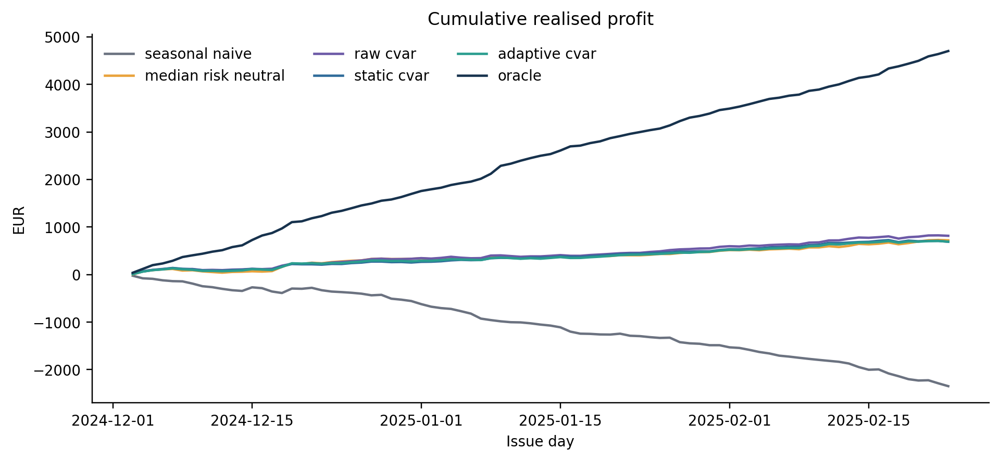
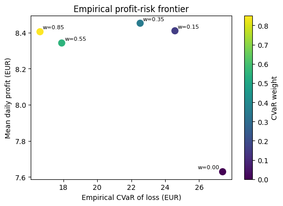
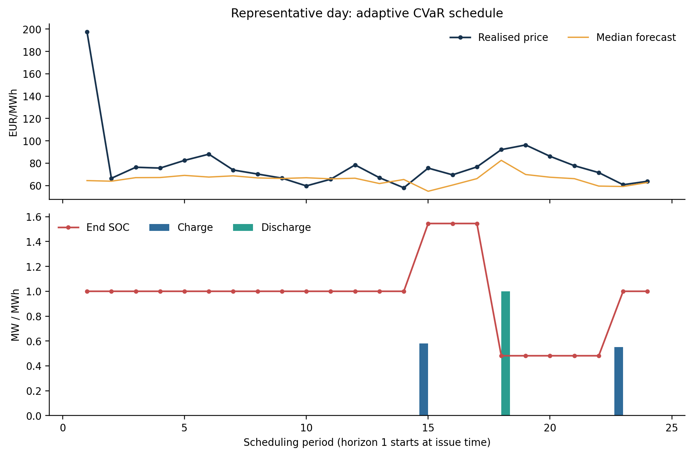

# Forecast uncertainty and simulated storage scheduling

Reference study: 18 October 2026 · Technical update: 21 October 2026 · v1.1.0

**Evidence scope.** Original numerical references were prepared on 18 October 2026. A separate section below reports the fresh 21 October supplementary study. Earlier personal-run and CI records retain their dates and version scope; the published alpha fix and later local work are distinguished in `PROJECT_HISTORY.md`.

## Abstract

A battery scheduling benchmark connects seven hourly forecast quantiles to risk-neutral and mean–CVaR decisions. This revision corrects an omitted physical restriction by adding binary charge/discharge modes, imports the corrected Project 1 forecasts, and uses common random numbers to compare uncertainty modes fairly. Across 83 simulated scheduling days, all saved corrected schedules satisfy full physical diagnostics at tolerance 1e-7. At CVaR weight .55, adaptive scenarios yield mean profit 8.34 EUR/day and empirical 90% CVaR loss 17.90 EUR, compared with raw scenarios at 9.82 and 20.67 EUR. Adaptive scenarios therefore sacrifice mean return for lower tail loss in this particular run; they do not dominate all alternatives. Three scenario-draw seeds and three simulated market seeds expose meaningful sensitivity.

## Study design and information timing

Each test day contains 24 scheduling periods. The baseline input has 1,992 corrected P1 rows, 83 days, seven ordered quantiles, realised simulated prices, seasonal forecasts, and static/adaptive interval endpoints. Each stochastic strategy receives 60 scenarios. The battery has 2 MWh capacity, 1 MW power, charging and discharging efficiency .94, initial/terminal SOC 1 MWh, and throughput cost 2 EUR/MWh. The CVaR confidence level is .90. Forecast fitting and calibration are documented in the corrected P1 report.

Horizon 1 has issue time equal to target time on every test day. No prior-day forecast publication or market gate-closure timestamp is supplied. The experiment is consequently a **simulated 24-hour scheduling benchmark**; it does not establish operational day-ahead availability, implement bid curves or measure realised market revenue.

| Strategy, weight .55 | Mean profit | 5th percentile | CVaR loss | Mean regret |
|---|---:|---:|---:|---:|
| Seasonal naive | -28.28 | -80.73 | 82.64 | 84.93 |
| Median risk neutral | 8.69 | -22.75 | 24.00 | 47.95 |
| Raw CVaR | 9.82 | -15.23 | 20.67 | 46.82 |
| Static CVaR | 8.31 | -13.54 | 18.46 | 48.33 |
| Adaptive risk neutral | 7.63 | -21.95 | 27.39 | 49.02 |
| Adaptive CVaR | 8.34 | -14.50 | 17.90 | 48.30 |
| Perfect-foresight oracle | 56.65 | 26.24 | -24.68 | 0.00 |

All amounts are simulated EUR/day except the percentile and CVaR, which are EUR over daily outcomes. Regret is oracle profit minus strategy profit. A negative CVaR loss means that even the worst fixed tail mass remains profitable.

<!-- PAGE -->

## Physical model and the correction

For period t, charge c_t and discharge d_t are non-negative MW, SOC e_t is MWh, and mode z_t is binary. With one-hour periods, the model enforces:

`0 <= c_t <= P*z_t; 0 <= d_t <= P*(1-z_t); z_t in {0,1}`

`e_(t+1) = e_t + eta_c*c_t - d_t/eta_d; 0 <= e_t <= E`

`e_0 = e_T = E*initial_soc_fraction`

Each scenario s gives profit `pi_s = sum_t[p_(s,t)*(d_t-c_t) - k*(c_t+d_t)]`. All scenarios share one schedule. The minimisation objective is negative mean scenario profit plus `weight * CVaR_alpha(-pi)`. SciPy's `milp` interface calls HiGHS with relative MIP gap 1e-9. Binary modes enforce exclusivity inside the optimization; solver schedules are not clipped, cancelled or otherwise repaired after solving. SciPy documents the integrality and bound interface used here [2,3].

### Why exclusivity cannot be assumed

At a single price of -100 EUR/MWh, a lossy simultaneous cycle can be profitable in the continuous model while restoring terminal SOC. The reproducible regression uses E=2, P=1, both efficiencies .94, initial/terminal SOC=1 and cost=2:

| Formulation | Charge MW | Discharge MW | End SOC MWh | Profit EUR |
|---|---:|---:|---:|---:|
| Historical continuous LP | 1.0000 | .8836 | 1.0000 | 7.8728 |
| Corrected binary MILP | .0000 | .0000 | 1.0000 | .0000 |

This is a physical model defect even if a particular prior reference run happened not to show simultaneous activity. The optional `lp_relaxation` formulation exposes the historical behavior for comparison; it is not the default schedule.

### Fixed-probability-mass CVaR retained

Rockafellar–Uryasev CVaR minimises `zeta + mean(max(loss_s-zeta,0))/(1-alpha)` [1]. The implementation retains the verified exact empirical fixed-mass estimator. Sort losses from worst to best and average exactly `(1-alpha)*n` observations, weighting the boundary observation fractionally. Thus 60 scenario losses use six observations, while 83 evaluation-day losses use 8.3. Ties must not expand that probability mass. Independent LP comparisons, fractional-mass and near-tie tests verify the estimator.

Full diagnostics check finite values, non-negativity, power bounds, all SOC endpoints, every SOC transition and inter-period continuity, initial/terminal SOC and exclusive operation. Counts are reported separately and in aggregate; tolerance is 1e-7.

<!-- PAGE -->

## Scenario construction and comparative results

Scenario uniforms use one shared normal factor and independent hourly factors: `latent = .65*common + sqrt(1-.65^2)*idiosyncratic`. Distinct latent hours therefore have Gaussian Pearson correlation .4225. This exchangeable dependence structure is a modeling assumption. It does not estimate hour-specific temporal dynamics.

Each hour interpolates the seven forecast quantiles at the latent rank. Values beyond q05/q95 use the boundary quantiles. Static and adaptive curves rescale deviations about q50 by `clip(interval_width / max(q90-q10,1e-6), .35, 4)`. This is a width-based heuristic, not the transformation of conformal coverage into a calibrated joint price distribution. It need not reproduce asymmetric interval endpoints. In the corrected baseline, the upper cap affects one static and three adaptive rows; no source interval is infinite. Other valid P1 outputs may have infinite intervals when a finite-sample order is unavailable: P2 explicitly counts them and caps their scale at four, discarding interval equivalence.

For each day, the seed is `scenario_seed + 17*day_index`. Raw, static and adaptive curves use identical uniforms. All frontier weights reuse the same draws as the main adaptive strategy. Thus changing an uncertainty mode or weight does not introduce an unrelated random sample.

| CVaR weight | Raw mean / tail | Static mean / tail | Adaptive mean / tail |
|---|---:|---:|---:|
| .55 | 9.82 / 20.67 | 8.31 / 18.46 | 8.34 / 17.90 |
| .70 | 9.63 / 20.12 | 8.19 / 18.37 | 8.17 / 17.95 |
| .85 | 9.51 / 19.67 | 8.64 / 16.86 | 8.41 / 16.62 |

Cells contain mean daily profit / empirical CVaR loss in EUR. Observed out-of-sample profit and tail loss need not vary monotonically with the in-sample penalty. The raw strategy has higher mean profit in all three baseline comparisons; the adaptive strategy has lower tail loss. The oracle has future information and is only a diagnostic upper bound.

<!-- PAGE -->

## Sensitivity to finite scenario draws

Three scenario-draw seeds (20260817, 20260818, 20260819) use the same corrected baseline P1 forecasts and market outcomes. Each run uses 60 scenarios and 83 full scheduling days. These are Monte Carlo sensitivity checks, not three independent market backtests. Numbers below are averages and ranges over these three seeds; they are not confidence intervals.

| Weight | Strategy | Profit avg (min–max) | CVaR avg (min–max) |
|---|---|---:|---:|
| .55 | Raw | 9.11 (7.79–9.82) | 23.24 (20.67–26.90) |
| .55 | Static | 8.25 (7.41–9.04) | 19.81 (17.61–23.34) |
| .55 | Adaptive | 8.48 (7.48–9.60) | 19.59 (17.70–23.18) |
| .70 | Raw | 9.10 (7.92–9.74) | 22.43 (20.12–24.92) |
| .70 | Static | 8.36 (7.50–9.38) | 17.70 (15.30–19.45) |
| .70 | Adaptive | 8.56 (7.94–9.55) | 18.53 (16.49–21.17) |
| .85 | Raw | 9.13 (7.98–9.91) | 21.57 (19.67–23.19) |
| .85 | Static | 8.55 (7.77–9.24) | 16.13 (13.87–17.65) |
| .85 | Adaptive | 8.61 (8.01–9.42) | 17.64 (15.68–20.60) |

The adaptive strategy has lower average tail loss than raw across these seeds, but static has lower average tail loss than adaptive at weights .70 and .85. Hence the study supports a conditional risk–return tradeoff, not universal adaptive superiority. The spread across just three draws also motivates larger scenario sets or explicit scenario-count convergence checks before stronger conclusions.

The plotted points describe a discrete empirical evaluation curve, not a certified efficient frontier. Mean profit rises and falls because realized benchmark outcomes differ from the scenario objective. Right-edge labels are placed inward so the colorbar cannot obscure them.

<!-- PAGE -->

## Sensitivity across three simulated market seeds

Two additional corrected P1 exports regenerate the simulated market and refit the forecast/calibration pipeline with seeds 20260818 and 20260819. They each provide 1,992 rows for the same 83 test-day positions. P2 keeps scenario seed 20260817, CVaR weight .55, 60 scenarios and identical battery settings. These checks vary the simulated data realization; they do not substitute for independent real-market validation.

| Market seed | Raw mean / tail | Static mean / tail | Adaptive mean / tail |
|---|---:|---:|---:|
| 20260817 | 9.82 / 20.67 | 8.31 / 18.46 | 8.34 / 17.90 |
| 20260818 | 10.22 / 25.89 | 8.71 / 19.80 | 8.78 / 20.53 |
| 20260819 | 11.57 / 21.29 | 10.80 / 18.24 | 11.04 / 17.11 |

Cells contain mean daily profit / CVaR loss in EUR. Adaptive has lower observed tail loss than raw on all three simulated market seeds. Static has lower tail loss than adaptive on seed 20260818, while raw has higher mean profit on each seed. Three synthetic realizations do not establish statistical significance or generalization across electricity markets.

### Historical comparisons require care

The old v1.0.2 baseline reported adaptive mean profit 9.8587 EUR/day and CVaR loss 16.2264 EUR. These are historical results, not current values. The corrected baseline is 8.3429 and 17.9035 EUR. The input P1 CQR correction, common random numbers and MILP formulation changed together, so their difference is not an estimate of the isolated effect of exclusivity. Prior personal checks reproduced the old software and do not validate the corrected edition.

The complete historical input, numerical outputs, prior report, notes and report-generation script are retained under `historical_v102/`. No old evidence has been rewritten as new verification.

<!-- PAGE -->

## Supplementary idle and scenario-count evidence — 21 October

This fresh study fixes the corrected baseline simulated market, battery, alpha .90 and weight .55. Only static/adaptive CVaR are compared, for N=60/200, three paired scenario seeds (20260817/18/19) and all 83 days. For each day/seed, one N=200 uniform array is drawn; N=60 takes its exact prefix, and both modes share the same ranks. All 249 prefixes and their hashes are recorded.

The N=60 prefix differs from the historical standalone N=60 RNG layout. These results are therefore a separate scenario-count study, not a claimed repetition or replacement of the old baseline. All 12 individual results and ranges are retained under `corrected_v110/supplementary_20261021/`.

| N | Strategy | Mean profit avg | CVaR loss avg | Solve seconds |
|---|---|---:|---:|---:|
| 60 | Static | 8.217827 | 19.697112 | 2.833 |
| 200 | Static | 9.712681 | 14.668371 | 5.605 |
| 60 | Adaptive | 8.242171 | 20.727489 | 2.290 |
| 200 | Adaptive | 9.519176 | 17.841339 | 5.014 |

Profit is simulated EUR/day; CVaR is EUR over daily outcomes. Averages are over three seeds. Timing totals optimization calls for each row across all seeds/days, excludes scenario generation and I/O, and is machine/load dependent. Main-loop wall time was 17.194 seconds.

| Seed | Strategy | Profit change | CVaR change | Action change |
|---|---|---:|---:|---:|
| 20260817 | Static | +2.491519 | -9.562180 | 1.834897 |
| 20260818 | Static | +0.462989 | -0.874846 | 1.674168 |
| 20260819 | Static | +1.530054 | -4.649199 | 1.793132 |
| 20260817 | Adaptive | +2.523262 | -4.816999 | 1.530517 |
| 20260818 | Adaptive | +0.202391 | -2.525817 | 1.391540 |
| 20260819 | Adaptive | +1.105363 | -1.315634 | 1.624484 |

Changes are N=200 minus N=60. Action change is mean daily L1 charge-plus-discharge change in MWh; 6.361–7.446 hours/day change above 1e-7 MW. All six pairs improve mean profit and CVaR here, but adaptive seed 20260817's fifth-percentile profit worsens from -18.345239 to -20.323186 EUR. Two counts and three seeds do not prove convergence or general superiority.

The zero-transaction alternative holds initial SOC and earns exactly zero profit and CVaR loss on all 83 days. It clarifies that negative-profit trading can underperform feasible inaction, without changing the old seven-strategy outputs. All 996 strategy schedules and 83 idle schedules pass full diagnostics: 1,079 schedules, 25,896 periods, zero violations. This bounded synthetic check provides neither calibrated joint scenarios nor real-market validation.

<!-- PAGE -->

## Verification, boundaries and reproducibility

Local Windows checks used the existing read-only Python 3.13.15 environment with NumPy 2.3.5, pandas 2.2.3 and SciPy 1.17.0. Imports came from this checkout's `src/storage_decision/`; bytecode was disabled and plotting cache redirected.

The **18 October reference package** passed 20 tests and 18/18 release comparisons at tolerance 1e-8, with zero numeric difference and 3,486 saved/rerun schedules (83,664 periods) checked. The later alpha fix was merged in PR #3 as main `5095b58`; its six post-merge jobs passed in Actions run `39504949986`. Those records retain their original version scope.

The **21 October local update** passes 35 tests, adding output protection, CLI forwarding, cache provenance, nested ranks and a fresh-study regression. Its three-weight verifier again passes 18/18 comparisons with zero difference and 3,486 checked schedules. Logs are in `evidence/local_verification_20261021/`; these local results do not claim new remote CI for this update.

The earlier scenario-draw and market-seed studies contain 11 unique complete runs. Their separate saved-output audit checked 6,391 daily schedules and 153,384 periods: zero violations, maximum SOC-transition residual 5.9952e-14 MWh and zero terminal-SOC error, without postprocessing.

Battery sensitivity uses only median risk-neutral scheduling on the first 28 days, not adaptive CVaR over all 83 days. New plots label this scope; archived figures and numerical references are unchanged.

### Practical limits

No observed market or grid data are used. Simulated regimes, tails and dependence may differ from real markets. Marginal intervals do not establish joint path calibration; tail/width clipping also prevents a conformal coverage interpretation for scenarios. The price-taking battery assumes perfect hourly execution and linear throughput cost, omitting network limits, bids, imbalance, reserves, gate closure and detailed degradation. Deployment would require publication-time-safe real inputs and independent-period validation of the whole pipeline.

### Reproduction and evidence

Follow the README for fresh `local_runs/` destinations and explicit same-type overwrite permission. No files are deleted; source and evidence paths are protected. Study scripts default to fresh execution; `--reuse-reference` validates and labels supplied caches. Original logs remain in `evidence/local_revision_20261018/`; current logs are indexed above. The baseline input SHA256 is unchanged and recorded in `data/README.md` and run manifests.

### References

[1] Rockafellar, R. T. and Uryasev, S. (2000). Optimization of Conditional Value-at-Risk. Journal of Risk, 2(3), 21–41. Original author-hosted paper: https://sites.math.washington.edu/~rtr/papers/rtr179-CVaR1.pdf

[2] SciPy. `scipy.optimize.milp`: mixed-integer linear programming, integrality/bounds/constraints and HiGHS interface. Official documentation: https://docs.scipy.org/doc/scipy/reference/generated/scipy.optimize.milp.html (consulted 18 October 2026; local experiments used SciPy 1.17.0).

[3] HiGHS. Official project documentation and solver description: https://highs.dev/ (consulted 18 October 2026).
